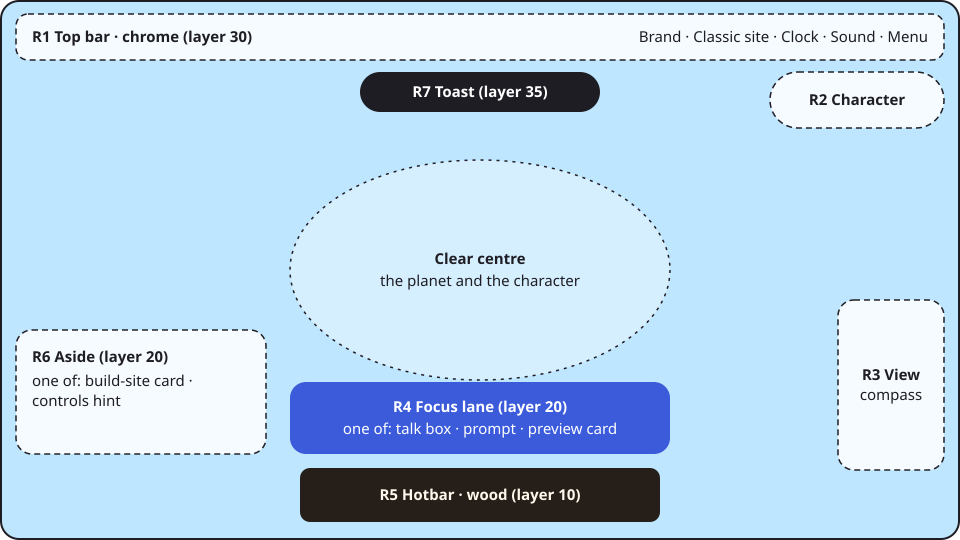
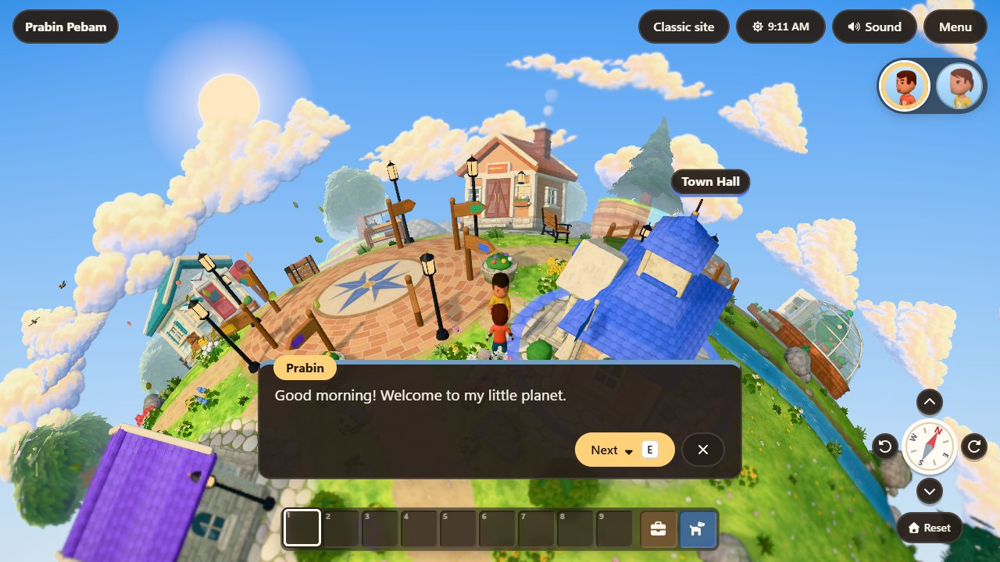

# Game UI design system

> **TL;DR.** The rules for every piece of the game's UI, and the loading shell before it (the website has [its own system](../site-ui/design-system.md)). All values come from **tokens** (one DTCG 2025.10 file, three tiers, generated CSS). Components read colour only through **surface roles**: the game pairs **Paper** (light) with **Wood** (dark), following the shared theme; key caps stay light. Reading overlays frost and tint the planet. The screen is split into fixed **regions** with the centre kept clear. A pure **arbiter** (`ui/lanes.ts`) decides the one thing that may ask for attention, and it decides what <kbd>E</kbd> does as well. Copy is warm, plain and short. Tests enforce all of this (`tests/unit/designSystem.test.ts`, `tests/unit/lanes.test.ts`). The research and the critique behind these rules are in [the spec](spec.md). The token list is in [tokens.md](tokens.md).

## 1. Principles

These are ranked: when two conflict, the higher one wins.

| # | Principle | What it means in practice |
|---|---|---|
| P1 | **The planet first** | The centre of the screen belongs to the world. The HUD lives on the edges, is small, and hides when there's nothing to say. |
| P2 | **One thing asks at a time** | At most one surface asks for attention in the focus lane, and <kbd>E</kbd> always does what that surface says. There's never a second "press E". |
| P3 | **The prompt tells the truth** | The prompt names the verb and the object that <kbd>E</kbd> will act on right now. If <kbd>E</kbd> would do something else, the prompt is wrong. |
| P4 | **One meaning per surface** | The game is one consistent surface: paper in light mode, wood in dark. Key caps keep their light face, so a key reads as a key. Never mix panel themes within one region. |
| P5 | **Tokens, not values** | A colour, size, space, radius, shadow, duration or layer that isn't a token is a bug. Add a token first. |
| P6 | **Calm motion** | Motion explains a change (appear, move, confirm); it never decorates. It's short, eased, and removed under reduced motion. |
| P7 | **Every cue has a text twin** | Anything shown by colour, motion, sound or a 3D cue (a wiggling chest) is also said in words: a prompt, a label, or a live-region announcement. |
| P8 | **The classic site is one step away** | From any state, one visible control leads to the plain-HTML content. |
| P9 | **Warm, plain words** | Talk like a friendly guide: short sentences, everyday words, no jargon, no blame (§7). |

## 2. The framework for deciding

When something new wants to be on screen, answer these in order:

1. **Is it needed now?** If the player can't act on it or it doesn't change what they'll do next, it's a toast at most, or nothing.
2. **Who owns input?** It follows the input-owner order (§6.2). A new surface that takes keys is a modal or a panel, never a HUD element.
3. **Which region?** Pick one from §5. If none fits, it doesn't go on screen: talk to the owner.
4. **Which rank?** In the focus lane or the aside, give it a rank in `lanes.ts` and a unit test. Never make two things visible by giving one a higher z-index.
5. **Which components and tokens?** Reuse a component from §4; add component tokens (`c.*`) only when it needs values the semantic tier doesn't have.
6. **What does it say?** Write the copy with §7, and add the live-region announcement (P7).

## 3. Tokens

The source of truth is `src/design/tokens.json`, in the [W3C Design Tokens (DTCG 2025.10)](https://www.designtokens.org/tr/drafts/format/) format. `node scripts/build-tokens.mjs` generates `src/styles/tokens.css` and [tokens.md](tokens.md). Never hand-edit either; the unit test fails if they're out of date (`--check`).

**Format.** Values are 2025.10 objects, the same conventions as the site's tokens (the values themselves are separate):
- a colour is `{ colorSpace: "srgb", components, hex }`, with `alpha` when it's translucent;
- a dimension or a duration is `{ value, unit }` (px or rem; ms or s);
- a shadow is `{ color, offsetX, offsetY, blur, spread, inset? }`, or a list of them;
- what DTCG has no type for is a number with its unit in `$extensions`: `game.unit` (`%`, `em`), `game.fluid` (a `clamp()` between `min` and the value, growing with `vw`), `game.filter` (a shadow written as `drop-shadow()`).

`designSystem.test.ts` checks the format, and that every token is read (by a stylesheet, the game's code or another token), except a deprecated alias in its one release.

**Changes and deprecation.** The build compares the tokens with the last set it built (`src/design/token-history.json`, generated and committed with them) and writes what was added, removed, renamed, changed in value or deprecated to [the token changelog](token-changelog.md), under that day's date; `--check` fails when the tokens changed without a build. A token is never renamed or removed in one step:
1. Add the new token with the old value, and turn the old one into an alias of it marked with DTCG's `$deprecated`, saying what to use instead (`"$value": "{c.chopper.thumb-width}", "$deprecated": "Use --c-chopper-thumb-width"`).
2. Move every reader to the new name in the same change. The build still writes the old custom property and marks it in [tokens.md](tokens.md) and the changelog.
3. Keep the alias for one release, then remove it.

`tokenChangelog.test.ts` fails when a stylesheet, the game's code or a live token reads a deprecated name. The first rename through it: `--c-chopper-thumb-w` and `-h` became `--c-chopper-thumb-width` and `-height` (19 October 2026).

| Tier | Prefix | Who may use it | Examples |
|---|---|---|---|
| 1. Primitives | `--p-*` | Only other tokens. Never component CSS (the lint rejects it) | `--p-color-wood-900`, `--p-color-gold-300` |
| 2. Semantic | `--color-*`, `--space-*`, `--radius-*`, `--border-*`, `--font-*`, `--text-*`, `--weight-*`, `--leading-*`, `--tracking-*`, `--shadow-*`, `--dur-*`, `--ease-*`, `--layer-*` | All CSS | `--space-4`, `--text-sm`, `--layer-lane` |
| 3. Component | `--c-*` | Only its owner (below) | `--c-btn-h`, `--c-lane-edge`, `--c-view-size` |

**Owners.** Every `c.*` group names who reads it in `$extensions["game.owner"]`:
- a component, by its name: the React function that writes its classes (`ViewControls`, `TalkBox`, `CraftPane`, `KeyCap`, …);
- a class family, when no component writes it: `.stick` (the floating stick, which the touch chunk draws) or `.load-*` (the loading scene in `play.astro`);
- `shared`, when several components read it: the button's heights (`btn`), cards, slots, the hotbar and lanes (they feed the page-wide `--slot`, `--hotbar-h` and `--lane-bottom`) and the scrollbar.

A stylesheet rule may read a group only if its selector names a class its owner writes (or one of the family's); a keyframe step counts as its animation's name. Only the owner's own file may read one from code. `designSystem.test.ts` holds both. The build ignores owners: they aren't values, so they don't reach `tokens.css` or the changelog.

**More contrast.** Paper and wood each have three strong roles, `text-muted-strong`, `border-strong` and `line-strong`. Under `@media (prefers-contrast: more)`, `base.css` points `--surface-text-muted`, `--surface-border` and `--surface-line` at them, on `:root` and on every surface. That's the one place a stylesheet re-points a role, and only to its own `-strong` role (tested).

**Surfaces.** A surface class maps the `--surface-*` roles (`bg`, `bg-soft`, `bg-warm`, `bg-sunk`, `bg-glass`, `text`, `text-muted`, `line`, `border`, `accent`, `accent-hover`, `on-accent`, `link`, `focus`, `highlight`, `highlight-soft`, `positive`, `negative`) to one colour set:

| Surface | Where | Look |
|---|---|---|
| `.surface-wood` | `body.play` (the whole game), the backpack, crafting, paint and the dialogs on it | Light paper with ink and blue actions, or dark wood-brown with cream text, gold actions and light-blue links, paired by `light-dark()`. Key caps stay light. Native controls inherit the root colour scheme. |
| `.surface-paper` (the default, on `:root`) | The default under the game's surfaces: the loading shell before the planet, and the key caps. (The website used it until 2026-09-29, when it moved to its own, separate design system: [site design system](../site-ui/design-system.md).) | Warm off-white, ink text, blue primary actions and links. |

Both surfaces define every role (a test checks), and each surface re-declares `color`, because inherited text colour doesn't follow a changed custom property.

**Themes (13 October 2026).** The game follows `site.theme` (Match system, Light or Dark), applied before paint. Change it in Menu's Settings or a reading overlay's place bar; the site, the frame and the game share the saved choice. Other tabs and live OS changes follow too. The game's own theme helper imports no site code, React or three. This changes only DOM UI, never the planet's time of day. Reading overlays frost the planet with the `blur.reading` token on the transparent parent dialog; the site's smoke remains on top ([sections §6.2](../sections/spec.md#62-the-planet-frame)).

**Scales.** Space is a 4 px grid in rem (`--space-0-5` … `--space-18`). Type is `--text-2xs` (0.625 rem) to `--text-3xl`. Every size is in `rem`, so the "Larger text" setting (`html.text-lg`, 112.5 %) scales it all: spaces, radii, controls, panels, slots and the HUD's places. Only lines and outlines (`--border-*`, focus offsets included), the pill shape, blurs and the scrollbar's line stay in px, and the test lists them. Layers are named, not numbered: `base` 1 < `hud` 10 < `lane` 20 < `fade` 25 < `chrome` 30 < `toast` 35 < `overlay` 40 < `greeting` 42 < `drag` 45 < `skip` 1000.

**Queries and feedback.** `@media` can't read a variable, so every width and height query writes a `breakpoint.*` value (in rem: `xs` 480 px to `3xl` 1100 px, and `h-sm` to `h-lg` for heights; tested). A press or a lift moves by `--shift-*`, a nod tips by `--tilt-nod`, and a pop scales by `--scale-*`. A key cap, a button's gap and the other details that follow the text's size are component tokens in `em`; the only `em` written in a stylesheet is `1em`.

## 4. Components

Each component has one class family, reads only surface roles and tokens, and has **its own stylesheet beside the others in `src/game/ui/styles/`**, named for it (`hotbar.css`, `talk-box.css`, `preview-card.css`), **imported by the component whose markup writes its classes** (`import './styles/hotbar.css';` in `Inventory.tsx`). What every page needs is `src/styles/`: `global.css` (the entry: the layer order and the imports), `base.css` (element and global rules only: the reset, type, focus, the surfaces, `.sr-only`, `.muted`, `.kicker`, the shared keyframes and the page-wide layout variables) and the two generated files. Astro hoists the CSS a component imports into the page's own stylesheets, even from a chunk that loads later, so a stylesheet costs the game's JS nothing and is there from the first paint; `play.astro` also imports the sheets of what it draws before any script (the top bar, the loading scene, the welcome), so the development server shows them at once too.

**Cascade layers.** Every game style sits in a layer, declared in this order at the top of every stylesheet (so it never depends on which one the browser meets first):

| Layer | What | Where |
|---|---|---|
| `tokens` | The custom properties | `tokens.css` (generated), layered where `global.css` imports it |
| `base` | Reset, type, focus, utilities, more contrast, reduced motion | `base.css` |
| `primitives` | The primitives' and the shared parts' own looks: Button, KeyCap, Icon, Dialog, Panel, ScrollArea, the card, the slot and the focus lane | `button.css`, `key-cap.css`, `icon.css`, `dialog.css`, `panel.css`, `scroll-area.css`, `card.css`, `slot.css`, `lane.css` |
| `components` | Every other component, which lays the primitives out and adjusts them | the rest of `src/game/ui/styles/` |
| `cursors` | The game's cursors: a cursor state always wins | `cursors.css` (generated), layered where `global.css` imports it |

A later layer wins whatever the selectors, so a component's rule beats a primitive's without a longer selector, and a rule's place among the stylesheets never matters. Within a layer, two stylesheets never style one element's property at the same specificity (checked when the styles were split: [as built](#as-built-styles-and-gallery)). Nothing of the game is outside a layer, so the cascade is the same in every build; the website's styles never reach `/play`.

| Component | Class | Stylesheet | Anatomy and variants |
|---|---|---|---|
| Button | `.btn` | `button.css` | Label (verb first), optional icon (`Icon`, `aria-hidden`), optional `.kbd`. Variants: default (soft surface), `.primary` (the accent; one per view), `.icon-btn` (icon only, with an `aria-label`). Height `--c-btn-h`, 44 px minimum target. |
| Key cap | `kbd` | `key-cap.css` | A light cap with dark text on both surfaces. It shows a key; it's never the only label. |
| Card | `.card`, `.card-title`, `.actions` | `card.css` | The surface's `bg`, `--radius-lg`, `--shadow-card`. An optional eyebrow, a title, a body and `.actions`. Landmark cards carry `--accent` as a top rule. |
| Dialog | `.dialog`, `.dialog-body`; the reading overlay `.reading-overlay` | `dialog.css`, `scroll-area.css`; `reading-overlay.css` | Native `<dialog>` (focus is trapped and restored; <kbd>Space</kbd> closes, and <kbd>Esc</kbd> too, §6.7). Title, body, actions with the primary action first; Close shows <kbd>Space</kbd>. |
| Menu, check, radio group | `.menu-dialog`, `.menu-view`, `.check`, `.radio-group`, `.help-list` | `menu-dialog.css` | The menu's groups, its settings rows (sound, time, larger text) and How to play's list; Close kept in reach. |
| Time badge | `.time-badge` | `time-badge.css` | The clock chip in the top bar; `.time-scrubbing` while dragging. |
| Top bar | `.play-header`, `.brand`, `.hud-actions`, `.icon-btn` | `play-header.css`; fast travel `fast-travel.css` | Brand (the site's home), Classic site, time, and the Sound, Fast travel, View whole planet and Menu icon buttons (a speaker, a map pin, the earth and a hamburger, named by `aria-label`; View whole planet carries `aria-pressed` and is made by its chunk once the planet is complete: [full planet](../poc-3d-navigation/full-planet.md)). Fast travel (T) is the menu dialog's travel page: a tile per place (`.travel-grid`, `.travel-tile`: its sign on an accent disc, its name, what's inside, its number key; the plaza is H), the arrow keys moving between tiles. It never wraps (the brand shortens on narrow screens). |
| Focus lane | `.lane` | `lane.css` | The bottom-centre slot above the hotbar. It holds one of: talk box, stand-up prompt, action prompt, preview card. |
| Action prompt | `.seat-prompt.action-prompt` | `action-prompt.css` | Icon + verb + object + `.kbd`. It's a real button (a click or tap does the same as <kbd>E</kbd>). |
| Preview card | `.preview-card` | `preview-card.css` | The landmark's eyebrow, title and one line, with Enter to open. |
| Talk box | `.talk-box` | `talk-box.css` | Name, the line (typed; instant under reduced motion), "more" cue, Next (<kbd>E</kbd>) and Close (<kbd>Space</kbd>) actions. |
| Aside | `.aside` (`.site-card`) | `site-card.css` | Bottom left: the site card (a build goal's needs). |
| How to play | `.menu-dialog`, `.help-list` | `menu-dialog.css` | The menu dialog's help page (the notice board, or Menu → Show controls): the controls with inline `kbd`, or the touch gestures, and tips. |
| Toast | `.toast` | `toast.css` | Top centre, one at a time, announced; 4 to 9 s by length. |
| View controls | `.view-controls`, `.compass`, `.view-home` | `view-controls.css` | The compass and Reset, bottom right. Turning and tilting without a drag are the menu's View group (`.menu-view`). |
| Character picker | `.character-picker`, `.avatar-btn` | `character-picker.css` | A radio group of portraits, top right. |
| Cursors | `cursors.css` (generated) | `cursors.css` | The game's own mouse cursors (the website keeps the system's): **arrow** (the default), **pointer** (a button, a link, a slot, a recipe, a landmark to travel to), **walk** (over the ground: the arrow with the gold ring the click leaves), **not allowed** (a disabled control), **grab** and **grabbing** (dragging the planet's view, turning Chopper on his card), **ew-resize** (the clock's scrubber). Font Awesome Free shapes outlined in wood ink and cream with a soft shadow, so they read on the sky, the grass and the panels; 32 px with a 64 px copy for sharp screens (`image-set`), a system fallback on each. Made by `node scripts/build-cursors.mjs` (images in `src/assets/cursors/`, hotspots found from the pixels), which also writes the states' selectors: never edit `cursors.css` by hand. The ground state is `data-cursor="walk"` on the game region (a ray–sphere test on every mouse move, `WalkMarker`), a landmark under the mouse is `data-hover="landmark"`. |
| Hotbar and slot | `.hotbar`, `.slot`, `.slot-key`, `.slot-count` | `hotbar.css`, `slot.css` | Nine slots, the backpack and the whistle. The selected slot uses `--surface-highlight`. |
| Backpack, crafting, paint | `.inv-panel`, `.craft-panel`, `.paint-panel` | `panel.css`, `inventory-panel.css`, `craft-pane.css`, `paint-picker.css` | Wood panels on the overlay layer, at a fixed size: head (title, help button, tools, close) and sections; no help text of their own. The crafting screen is the inventory panel in two columns: the recipe book down the left, the detail over the backpack and hotbar (`.craft-book`, `.craft-grid`, `.craft-need`; [crafting screen](./crafting-screen.md)). |
| Help popover | `.help-pop`, `.help-btn`, `.help-card`, `.help-keys` | `help-popover.css` | A panel's keys and gestures behind a question-mark button ("Show controls") in its head: shown on hover or focus, pinned by a press, closed by <kbd>Escape</kbd> or leaving (WCAG 1.4.13). A key / what-it-does list per group, the touch gestures on touch. A game panel never spells its controls out inline. |

The rest of the game's own UI has a stylesheet each too: the loading scene (`load-scene.css`), the page (`play-page.css`: the body, the skip link, the container), the overlay and its centred card (`overlay.css`), the planet's region (`planet-region.css`), the travel fade (`travel-fade.css`), the floating stick (`stick.css`), a landmark's name in the world (`world-label.css`), what full planet hides (`full-planet.css`) and Chopper's card (`chopper-card.css`).

Adding a component: give it a class family and its own stylesheet in `src/game/ui/styles/` (opening with the layer order, everything inside `@layer components`, or `primitives` for a shared part), import it from the component that writes the classes, use only surface roles and tokens (add `c.*` tokens if needed), give it an entry in the gallery (§9.1), add its row here, and let the design-system test run.

### 4.1 Primitives

The game's TSX never writes a `<button>`, `<dialog>` or `<kbd>` itself: it uses these React primitives, which own each control's classes, name, states and surface (a unit test holds it).

| Primitive | Module | What it owns |
|---|---|---|
| `Button` | [ui/primitives.tsx](https://github.com/prabinpebam/atiya/blob/main/src/game/ui/primitives.tsx) | `type="button"`, `.btn` and `variant` (`primary`, or `bare` for controls with their own anatomy: slots, travel tiles, the compass, swatches, portraits). States are native: `disabled`, `aria-disabled` (busy or unavailable but focusable, like the crafting button), `aria-pressed`, `aria-expanded`. Every other prop (refs, handlers, `data-*`, `className` for layout) passes through. |
| `IconButton` | ui/primitives.tsx | An icon-only button: a required `label` (its `aria-label`) and an `icon` (through `Icon`); square `.icon-btn` unless `pill`. A button with an icon and a key cap but no words is a `Button` with an `aria-label`. |
| `KeyCap` | ui/primitives.tsx | The key cap: the `kbd` element itself (styled by `key-cap.css`), so it costs the initial bundle nothing. |
| `Dialog` | [ui/overlays.tsx](https://github.com/prabinpebam/atiya/blob/main/src/game/ui/overlays.tsx) | The native modal `dialog`: `open` keeps it in step (`showModal`, `close`), and `onDismiss` hears Esc, Space (`spaceBack`, §6.7) and the backdrop. `.dialog` unless `bare` (the reading overlay, which ignores its backdrop). |
| `Panel` | ui/overlays.tsx | A wood panel: the `.surface-wood` backdrop (`backdrop` props, `outside` for what floats over it) round a modal `role="dialog"` `.inv-panel`. |
| `ScrollArea` | ui/overlays.tsx | A scroller with the thin scrollbar (`.scroll-thin`), a `div` or a `ul`. |

The controls sit in the initial bundle, so they import only `Icon`; they cost it about 0.1 KB gz, and on 11 October 2026 left it 6 bytes under its 450 KB budget, which the deploy's base-path build then crossed. A landmark's preview card and the lost-view notice now load with the reading overlay's chunk (`Dialogs.tsx`, through Hud's `Later`: when they're needed, or 2 s after start), since neither shows at load: the initial bundle is 449.6 KB, 432 bytes under. The containers are used only by the screens that load on demand, so they're a separate module that the initial bundle never imports.

## 5. Screen regions

| Region | Where | Holds | Rule |
|---|---|---|---|
| R1 Top bar | Top edge | Brand, Classic site, time, sound, menu | Always visible in play (P8). |
| R2 Character picker | Top right, below R1 | Portraits | |
| R3 View controls | Bottom right | Compass, Reset | |
| R4 **Focus lane** | Bottom centre, above the hotbar | One of talk, stand, prompt, preview | Decided by `focusLane` (§6.3). |
| R5 Hotbar | Bottom centre edge | Slots, backpack, whistle | |
| R6 Aside | Bottom left | Site card | Decided by `asideLane` (§6.4). |
| R7 Toast | Top centre, below R1 | One toast | Never in the lane. |
| Centre | The middle of the screen | The world | Nothing but world-anchored labels (landmark names) and the fade. |
| Overlay | Full screen | Dialogs and wood panels | Takes the keys; R4 and R6 stay empty. |

On narrow or short screens (`COMPACT_QUERY`: ≤ 760 px wide, or ≤ 500 px tall, a phone held sideways) the aside gives way whenever the lane has something. On short screens the preview card also drops its summary, keeping its title and actions.

## 6. Priority

### 6.1 The layer stack

Use `--layer-*` only; a raw z-index fails the lint. From bottom to top: `base` (the canvas), `hud` (the chrome's regions), `lane`, `stick` (the floating touch stick, over the lanes because it sits under the thumb and never takes a touch), `fade` (travel), `chrome` (the top bar stays above the fade), `toast`, `overlay` (dialogs, panels, and the loading scene), `greeting` (Prabin's welcome on the page, over the loading scene until the game takes it over: [progressive loading](../poc-3d-navigation/progressive-loading.md) §5.3), `drag` (an item on the cursor), `skip` (the skip link). World-anchored labels (drei `Html`) are capped below the HUD with `zIndexRange [9, 0]`.

### 6.2 Who owns input

The first match owns the keys: **modal** (landmark dialog, menu, Chopper's card) > **panel** (backpack, crafting, paint) > **conversation** (the talk box) > **seated** (on a bench or a chair) > **world** (walking, targets). Keys only act while the game region has focus, and Tab is never intercepted (WCAG 2.1.4).

### 6.3 The focus lane

`focusLane(state)` in `src/game/ui/lanes.ts` returns one of the following:

1. `talk`: a conversation is open;
2. `stand`: seated, so the prompt is "Stand up" (where the seat has something to do, it's two buttons: the seat's action on <kbd>E</kbd>, "Feed the ducks" on the pond bench or "Swing higher" on the swing, and "Stand up" on <kbd>Space</kbd>);
3. nothing while an action is playing out (chopping, mining);
4. `prompt`: there's a target;
5. `preview`: a landmark is near;
6. nothing.

It returns nothing before play, while travelling, and under any overlay. Under an overlay, `laneBeneath` says what the lane *would* hold, and the HUD keeps that surface mounted but `hidden`, so the button that opened a dialog is still there to take the focus back when it closes. The HUD renders only the winner, and `controller.interact()` (<kbd>E</kbd>) acts on the same winner, so what's on screen and what <kbd>E</kbd> does can't disagree (P2, P3).

### 6.4 The aside

`asideLane(state, compact)` shows the site card while the build site is the target (so it never shows while you use something else near it). It shows nothing during a conversation, and on compact screens nothing while the lane is busy. Onboarding isn't an aside: Prabin's welcome, in the talk box, opens the game, and the controls are on the How to play page (the notice board, the menu).

### 6.5 Target tiers

When several things are in reach, `pickTarget` (`systems/interactables.ts`) adds a tier penalty (`TIER_U`) to the distance score:

| Tier | Kinds | Penalty |
|---|---|---|
| 0: people and purposeful objects | NPC, chest, crafting table, build site, bench, watering can, notice board | 0 |
| 1: things to gather or tend | Tree, boulder, flower, garden plant | 0.1 u |
| 2: the companion | Chopper | 0.45 u |

So Chopper, who follows you everywhere, never takes the prompt from the person you walked up to.

#### How close, and which one

A target is offered while you're within its reach of its edge (so a big tree and a small flower feel alike), in front of you, and usable now. The best score wins: distance past the edge, plus how far it's off your heading, plus its tier. The current target keeps its prompt 0.25 u past its reach (`REACH.keep`), so it doesn't flicker as you shuffle.

| Target | Reach (u) | Measured from | Also |
|---|---|---|---|
| Tree | 1.05 | its trunk's collision edge | |
| Boulder | 1.0 | its edge | |
| Flower | 0.9 (0.5 by a landmark) | its centre | |
| Chest, crafting table | 0.95 | its edge | |
| Notice board | 0.9 | its edge | E opens How to play |
| Chopper's house site | 1.0 | the house's edge | its card shows only while it's the target; the ghost fades in from 6 u |
| Bench | `SEAT.enterU` | the seat | only from in front or the ends |
| Watering can, garden plant | 0.8 | their edge | |
| Someone to talk to | 1.3 (`FAMILY.talkRange`) | their centre | within 65° of your heading |
| Chopper | 1.2 (0.8 by a landmark) | his centre | within 65° of your heading |
| Landmark card | footprint + 1.75 (`CONFIG.proximityPadding`) | its centre | goes once you're past it × `exitFactor`; hidden while a target takes E |

#### Things that move

- **Hysteresis for movers.** A person or Chopper stays the target 0.5 u past their reach (`REACH.keepMoving`), so one step of theirs doesn't take the prompt away.
- **They notice you.** When a family member who's walking somewhere becomes your target, they stop, turn to you and look at you for up to 4 s (`Family.notice`, `FAMILY.noticeS`), then carry on if you don't talk. Someone busy (in the middle of a chore, talking with someone else, or going through a door) doesn't stop. That's why walkers can be talked to at all: `canTalk` accepts anyone slow, or anyone who can notice you.
- **The marker follows them.** The target's ring is placed at the target's current position every frame.

#### One thing glows: the one E uses

`world/cues.tsx` (`ActivationCues`, in the wildlife chunk) marks what <kbd>E</kbd> would use, and only that:

- **The target:** a small gold ring on the ground round it (`markU` sets its radius where the edge isn't a good fit: trees and rocks clear their roots, people clear a chair; `markLift` raises it onto a raised bed), with sparkles rising from it.
- **The landmark:** a wide ring in the landmark's accent colour, draped on the ground round its footprint, with sparkles. It shows only while the landmark's card is up, so it goes whenever something nearer takes <kbd>E</kbd>.
- **The chest and crafting table** also wake and sparkle (`ReadyCue`).

The ring is a soft gradient band with highlights running round it; its hue drifts a little either side of the base colour (a small turn about the grey axis) without leaving the colour family. Sparkles are additive points that rise, drift, twinkle and fade. It costs 4 draw calls at most (two rings and two sparkle clouds, hidden when unused), with all motion in the shaders and no per-frame buffer uploads. Under reduced motion or when ambient motion is paused, the ring and sparkles hold still but stay visible, and they appear and go without fading. Every cue has its text twin: the prompt or the landmark card.

#### Click to walk: where you're going

A click or tap on the ground (the planet mesh) walks the character there (`controller.walkToWorldPoint`, which keeps the point in `controller.walkMark`), and `WalkMarker` (in `world/cues.tsx`, one more draw) marks it:

- **The ripple:** two pale gold rings spread from the point and fade (0.65 s, the second 0.14 s behind), so the eye sees where the click landed.
- **The marker:** a small ring pops in and breathes gently until the walk ends (you arrive, a key or a drag takes over, or you're stuck), then fades. A new click moves it.
- **Readable anywhere:** a soft dark halo under the gold, like the cursors' outline, so it shows on light paths and bright grass alike. It's draped on the ground (the planet curves, the land rolls), and its pale gold is lighter than the ring of what <kbd>E</kbd> uses, so the two don't read as one.
- **Reduced motion:** no ripple, and the ring holds still. Its text twin is the character walking there.

### 6.6 Toasts and the talk guard

- **One toast at a time; the newest replaces the last.** It stays `toastMs(text)` (4 to 9 s by length, WCAG 2.2.1), is announced in the live region, and never sits in the lane.
- **The talk guard.** The first <kbd>E</kbd> within `TALK_GUARD_MS` (0.3 s) of a conversation opening is ignored (a post-acceptance delay, per the Game Accessibility Guidelines), so a double press can't skip a line unread.

### 6.7 Keys: E does, Space goes back

The owner's rule for the whole game: one key does and one key goes back, and <kbd>Esc</kbd> isn't the way out that the UI shows.

- <kbd>E</kbd> (or <kbd>Enter</kbd>) does: open, use, talk, go on to the next line, sit. In a screen, <kbd>Enter</kbd> presses the focused button.
- <kbd>Space</kbd> goes back: it stands you up from a bench, gets you off the swing, ends a conversation, stops an action, and closes a dialog (a landmark's card, Chopper's card, the menu) or a panel (the backpack, the chest, the crafting table, the palette). It's the `back` action (`input/keyboard.ts`); in a screen, `spaceBack(e)` closes it unless the focus is on a control whose own key <kbd>Space</kbd> is (a text field, a checkbox, a radio button, a slider). On a backpack slot <kbd>Space</kbd> stays the slot's right-click, so there <kbd>E</kbd> or <kbd>I</kbd> closes, as in Minecraft. With nothing to go back from (walking about on the planet), <kbd>Space</kbd> jumps, as it does in nearly every game ([rest.md](../poc-3d-navigation/rest.md)): going back always wins, so a press never both closes something and jumps.
- <kbd>Esc</kbd> still works everywhere it did (it closes, and opens the menu when nothing is open), because people reach for it, but the prompts, buttons and copy show <kbd>Space</kbd>.
- The key a surface's way out uses is on its button: "Stand up <kbd>Space</kbd>", the talk box's close, the dialogs' Close.
- **The reading overlay keeps the rule.** A building opens its list and pages as the site's own pages, framed over the planet ([sections spec §6](../sections/spec.md#6-reading-on-the-planet-u13u15)). In the frame, <kbd>Space</kbd> closes it, back to the planet, like every other overlay; <kbd>Esc</kbd> does too, unlabelled. A picture's lightbox inside the page takes the key first, and a field or a switch keeps its own. The arrows, <kbd>Page Up</kbd> and <kbd>Page Down</kbd>, the wheel and a swipe scroll the page. The frame's own Close shows <kbd>Space</kbd>.

### 6.8 The reading overlay

- **What it is:** a full-window, modal `dialog` (`ui/Dialogs.tsx`, the lazily loaded chunk the landmark dialog was) holding a transparent `iframe` of `/play/<building>/` or `/play/<building>/<page>/`. Those pages are the site's, in the site's design system, over the site's smoke (paper-white in light mode, black in dark). The game adds only a status while the frame loads and a card with Try again, Open classic page and Close if it doesn't answer within 10 s.
- **The colour scheme is the site's,** not the wood's. The iframe's `color-scheme` is set from `site.theme` before it loads: a framed page's `prefers-color-scheme` follows it, and a frame whose scheme differs from the page's gets an opaque backdrop.
- **Messages:** `planet:ready` and `planet:close` from the frame, `planet:focus` to it, on the same origin only, and only from the open building's frame.
- **History:** the frame's moves replace its location, and the game keeps the address (`?at=…&open=1&page=…`) and its history marker current, so Back closes the overlay and Forward reopens it at the same page.

## 7. Copy

**Voice:** a friendly local guide. Warm, plain, brief, never cute at the expense of clarity. Chopper's lines may be playful; system messages are never jokes.

| Rule | Do | Don't |
|---|---|---|
| Sentence case everywhere | "Open chest" | "Open Chest" |
| Labels start with a verb, 3 words at most | "Classic page", "Craft", "Stand up" | "Click here", "OK", "Submit" |
| A prompt is verb + object, about 20 characters | "Talk to Prabin", "Chop tree" | "Press E to interact with the tree" |
| An error says what happened and how to fix it | "Not enough materials for Planks now. Check your backpack." | "Error: insufficient resources" |
| Name things the same way every time | the glossary below | synonyms |
| Contractions and "you" | "Couldn't find that place, so you're at the plaza." | "The requested location was not found." |
| No emoji or text symbols as icons | a Font Awesome icon plus a label | ☀ ▲ ↗ |
| Keys are shown as key caps, and never the only label | "Open chest <kbd>E</kbd>" | "<kbd>E</kbd>" alone |

**Glossary:** *planet* (the 3D world), *classic site* (the plain pages; *classic page* for one landmark's page), *backpack* (the inventory), *chest* (storage), *crafting table*, *hotbar*, *menu*, *the plaza* (lowercase, it's a place, not a title), *Chopper's house*.

The copy lint in the design-system test rejects emoji, "click here", "OK", "Submit", "Open full page" and "the Plaza".

## 8. Accessibility

- **Contrast:** the unit test checks every text role on every background of both surfaces, over the sky or the world behind translucent ones, plus the accent buttons, the toast and the talk plate at 4.5:1 (WCAG 1.4.3), and focus rings and borders at 3:1 (WCAG 1.4.11).
- **Targets:** at least 44 × 44 px (`--c-btn-h`, the view buttons on touch, slots). One exception, with its reason: hotbar slots are 28 px on a phone held upright (WCAG 2.5.8's 24 px minimum), because nine slots, the backpack and the whistle must fit 360 px ([touch controls](touch.md) §5.4).
- **Text:** functional text is at least 14 px (`--text-sm`); the smaller sizes are only for eyebrows and counts. "Larger text" in the menu scales everything by 112.5 % and is saved (`site.largeText`).
- **Focus:** a visible ring in the surface's `--surface-focus`; dialogs trap focus and give it back.
- **Forced colours** (Windows contrast themes, `@media (forced-colors: active)`): the HUD and panels take the system's colours; the planet's canvas can't. Each stylesheet ends with its controls' rules:
  - every control keeps a boundary (`ButtonText`) and its focus ring in `Highlight`;
  - a slot or a swatch, drawn by a fill and an inset shadow that forced colours drop, gets a border;
  - a state shown only by a fill or a shadow gets a `Highlight` border: the selected slot, avatar and photo, a spread or drop target, the place you're at, the running stick;
  - panels and tooltips get an outline, so they don't melt into the scrim;
  - the paint chips and the compass keep their own colours (`forced-color-adjust: none`), because their colours are what they show.

  System colours appear only in these blocks, and only `ButtonText`, `ButtonFace`, `ButtonBorder`, `Canvas`, `CanvasText`, `Highlight`, `HighlightText`, `GrayText` and `LinkText` (tested).
- **More contrast** (`prefers-contrast: more`, iOS Increase Contrast): muted text, outlines and rules take their strong roles (§3), at 7:1 for the text and 3:1 for the lines, and never weaker than the plain role (tested).
- **Logical properties:** margins, paddings, borders and positions use their logical names (`margin-block-start`, `padding-inline`, `border-block-end`, `inset-inline-start`, …), and text aligns to `start` or `end`, so the HUD can follow a right-to-left language. The game is left-to-right today, so they draw exactly as the physical ones did. Positions the code sets from a pointer or a measured box (a tooltip, a crafted item's flight) stay `left` and `top`: they're screen coordinates.
- **Motion:** every animation uses `--dur-*` and `--ease-*`, and `prefers-reduced-motion` shortens it to nothing (the talk box then shows lines instantly).
- **Text twins (P7):** prompts are buttons with names; toasts, talk lines and results are announced in the polite live region.
- **Keys:** scoped to the focused game region; Tab and the browser's keys are never taken.
- **Touch:** every drag has a single-pointer alternative (tap to walk, the menu's View buttons), and every two-finger gesture too (WCAG 2.5.1, 2.5.7). The world draws through the device cutout and home-indicator areas; controls stay inside their safe-area insets in both orientations. See §10.

## 9. Governance

- `tests/unit/designSystem.test.ts` checks:
  - generated tokens are up to date, and every `var()` is defined;
  - the tokens' 2025.10 format (colour objects, `{value, unit}`, shadow objects; no string values), that every token is read, and that sizes are rem (px only for the listed lines, outlines, blurs and the pill);
  - no colour literals and no `--p-*` in component CSS;
  - z-index only from layers; font sizes only from `--text-*`, a component token or `1em`; weight and leading from their scales; radius from the scale;
  - durations and easing from motion tokens, and no px/rem spacing literals;
  - every value is a token: a CSS parser (`postcss`, pinned) reads every game stylesheet (found by glob, so a new one can’t escape: `base.css` and every `.css` under `src/game/`) and finds no raw size, offset, blur, turn, time or scale outside an allow-list (`0`, `1em`, percentages, `100vw`/`100dvh`, quarter turns, and the named `.sr-only` and skip-link values), and every `@media` query at a breakpoint token;
  - only the three calculated layout properties (`--slot`, `--hotbar-h`, `--lane-bottom`) and the four OS safe-area insets (`--safe-*`) are free custom properties, besides the strong roles re-pointed for more contrast;
  - inline styles have no colour literals;
  - contrast on both surfaces, and wood defines every paper role;
  - the copy lint;
  - no `<button>`, `<kbd>` or `<dialog>` outside the primitives (§4.1), `IconButton` requires its `label`, and the initial bundle never imports the containers;
  - hover only where it can hover: every `:hover` rule inside `@media (hover: hover)`, each with an `:active` twin outside it (§10);
  - no physical property (`margin-top`, `left`, …) and no `text-align: left` or `right` (§8);
  - every control family (every class with a hover, press or focus state, and the focusable controls without one: `.icon-btn`, `.menu-item`, `.seat-prompt`, `.time-badge`, `.chopper-thumb`, `.craft-cell`) has a rule inside `@media (forced-colors: active)`, system colours only there, and the more-contrast block re-points muted text, borders and rules (§8);
  - every `c.*` group names its owner, and only its owner reads it (§3);
  - every export of the game's UI files (`src/game/ui/`, the crafting chunk's `ui.tsx`, the home chunk's `TalkBox.tsx`) has a `/** … */` comment right before it, and every prop of the primitives and containers has one;
  - styles beside their components, in layers (§4; review DS2-04): `src/styles/` holds only `global.css`, `base.css` and the two generated files; `global.css` declares the layer order and imports `tokens.css` and `cursors.css` into their layers; every game stylesheet opens with the order and holds only its own layer (`base`, `primitives` for the primitives' and shared parts' sheets, `components` for the rest), so no game style is outside a layer; `base.css` names no component's class; and every stylesheet in `src/game/ui/styles/` is imported by the modules that write its classes, every rule in it naming a class (or attribute) one of them writes. A rule no component owns fails;
  - the gallery (§9.1; review DS2-05): every primitive and every exported game UI component is drawn by the gallery (`<Name` in `src/game/gallery/`), every view the screenshot test visits is drawn, the page exists only in development and test builds, and it imports nothing of the website.
- `tests/unit/lanes.test.ts` covers the arbiter, the aside, the compact rule, toast timing, the guard and the target tiers.
- The E2E test "one thing asks at a time" talks to Prabin by a landmark, checks that only the talk box shows, and checks that <kbd>E</kbd> advances it. The E2E group "larger text" turns the setting on and checks that the menu, fast travel, the backpack and the hotbar keep every label whole and on screen.
- **To add a token:**
  1. Add it to `tokens.json` with `$type`, `$value` and `$description`, in the right tier. A new `c.*` group names its owner in `$extensions["game.owner"]`.
  2. Run `node scripts/build-tokens.mjs`.
  3. Use the CSS variable.
- **To add a component:** a `/** … */` comment before its export saying what it shows and does; its own stylesheet in `src/game/ui/styles/`, imported by it (§4); an entry in the gallery (§9.1); a control's class gets its forced-colours rule (§8), and its hover goes inside `@media (hover: hover)` with an `:active` twin.
- **To change a colour:** change the primitive or the role; the contrast test tells you if it still passes on both surfaces.
- **Exceptions:** the lint's exceptions are listed in the test with a reason. Add one only with a reason.
- **The audit:** what the [design systems audit](../site-ui/design-system-audit.md) found here and closed (DS-10 to DS-14) is recorded there; `node scripts/design-system-audit.mjs` re-takes the measures (DS2-04: game rules outside a cascade layer and shared stylesheets beyond `base.css`, both 0; DS2-05: the primitives in the gallery).

### 9.1 The gallery

The game's primitives and panels have a page of their own, `/play/gallery/` (review DS2-05, decided 19 October 2026): **in development and in `--mode test` builds only**, like the test hook. `integrations/game-gallery.mjs` injects the route only when the mode isn't production (the rule is pure in `integrations/game-gallery-rules.mjs`, unit-tested), and `verify:prod` fails if the page or its marker reaches `dist/` (`scripts/size-report.mjs`, "no game gallery in the production build"). It never imports the website, and nothing in the game imports it.

- **What it draws:** the real components from sample data (`src/game/gallery/samples.ts`: a real store and inventory behind a stand-in controller whose actions do nothing, the seven buildings with made-up words, a stand-in crafting chunk), one view at a time (`src/game/gallery/views.ts`): the controls (every `Button` variant and state, `IconButton`, `KeyCap`, `Icon`, the slots, `ScrollArea`), the HUD (the top bar, the prompt, the toast, the clock, the hotbar, the view controls, the character picker), seated, the preview card, the talk box, the site card, `Dialog`, `Panel`, the menu, How to play, fast travel, the backpack, the chest, the crafting table, the furnace, the palette, the reading overlay, the lost view and Chopper's card.
- **Surfaces:** `?surface=paper` (light) or `?surface=wood` (its own look, dark; `&theme=light` for wood's light look, which is paper's colours); `?view=<id>` for one view, the index lists them.
- **Screenshots:** `tests/e2e/visual-game.spec.ts` (the `visual` project) shoots every view on both surfaces at 360, 768 and 1280 px, the 3D canvas and the framed page masked.
- **Adding a component:** give it an entry (a view, or a place in one) drawn by the component itself; the unit test fails on an exported game UI component the gallery doesn't draw.

### As built: styles and gallery

19 October 2026 (review DS2-04, DS2-05). `hud.css` (953 lines), `panels.css` (765) and `components.css` were split into 35 stylesheets in `src/game/ui/styles/`, each imported by its owner, and every game style was put in a layer. The look is unchanged, checked three ways: a static comparison of the old and the new cascade (every pair of declarations that could meet on one element: no winner changed but those noted here); the computed style of every element of every gallery view, before and after, on paper and wood, at three widths, in forced colours and with reduced motion (210 captures, all identical); and the game's own states (the first paint with the welcome, the talk box, the HUD, the menu, fast travel, the backpack, a preview card, the crafting table, at 1280 and 390 px) drawn with the old and the new styles on the same page (identical computed styles, pixel-identical screenshots). Changes that draw nothing differently:

- dead rules removed: `.btn.big`, `.btn.sm`, `.menu-list` and `.menu-item` (no markup wrote them); `--c-btn-h-lg` is deprecated, nothing reads it;
- the talk box's name plate and line lost two margins `.card p` always outranked (the card's paragraph gap is what they had, and have);
- `[data-gate-hidden]` (the gate hiding the loading scene and the welcome) moved from the base to the loading scene's stylesheet, so it still beats `.load-scene`;
- under the touch input on a narrow screen, a preview card's row now takes the game's own pointer (the cursors layer) instead of the system's; a finger shows no cursor.

The CSS a component imports is hoisted into `/play`'s head by Astro; the sheets `play.astro` also imports for its first paint (the top bar, the loading scene, the welcome, the button, key cap, icon, card and lane) are in the page's CSS twice in a build (about 7 KB before compression), the cost of drawing them before any script in development as well.

## 10. Touch

The rules for playing under a thumb; the research, the critique and the plan are in [touch controls](touch.md).

- **The last input decides.** `<html data-input="touch|keys">` follows the last `pointerdown` or `keydown` (set by the touch chunk, mirrored in the store as `input`). Style touch-only changes with `[data-input='touch']`, never with a pointer media query: a touchscreen laptop can switch back and forth.
- **Hover only where it can hover.** Every `:hover` rule sits inside `@media (hover: hover)`, so a tap never leaves a control looking hovered, and has an `:active` twin outside it that shows the same change while a finger presses (as the website does; tested).
- **Full-bleed world, safe controls.** The game viewport uses `viewport-fit=cover`; `body.play`, the loading scene, the game container and the canvas fill `100dvh` edge to edge. The four `--safe-*` layout properties read `env(safe-area-inset-*)`. Every edge-anchored interactive region composes its token spacing with those insets: header, hotbar and focus lane, aside, compass, picker, dialogs, panels and the reading overlay. Never inset the canvas or world visuals. Both portrait and landscape are covered by the E2E test "the world fills iOS while controls stay inside portrait and landscape safe areas".
- **In touch mode:** keycaps in buttons and the hotbar's slot numbers hide; Prabin's welcome, the How to play page and the announcements use the touch copy (`input/touchCopy.ts`); the compass and Reset are 44 px.
- **Structure previews on phones:** at widths up to the `3xl` breakpoint (1100 px), touch input shows one compact row in the bottom focus lane, above the hotbar. The whole row is a named button: the building's title and Open, with a 44 px minimum target. Tapping opens the same reading overlay and closing restores focus to the row. The kicker, summary and classic-page link stay in the full preview for keyboard or mouse input and larger screens; the classic site remains reachable from the header. The E2E test "structure preview is one tappable bottom row on a phone" checks both orientations, 320 px, Larger text, opening, focus restoration and switching back to keys.
- **Gestures:** one finger dragged on the planet is the floating stick (`c.stick.*`); a second finger, or two together, turn and tilt the view; a tap walks. A touch that starts on a HUD control stays with it.
- **New touch copy** never names a key; the unit test checks it.
- **The chunk rule:** touch code (`input/touch.ts`, `stick.ts`, `gestures.ts`, `touchCopy.ts`) loads only on touch-capable devices. It imports nothing from the main bundle but types, and the main bundle keeps only the glue (`controller.touch`).