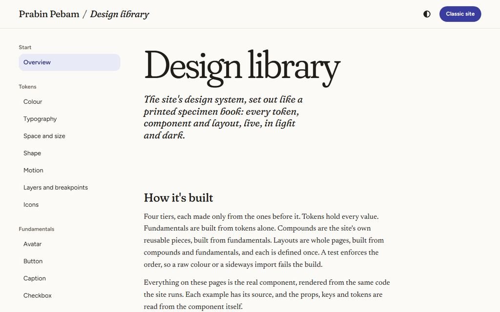
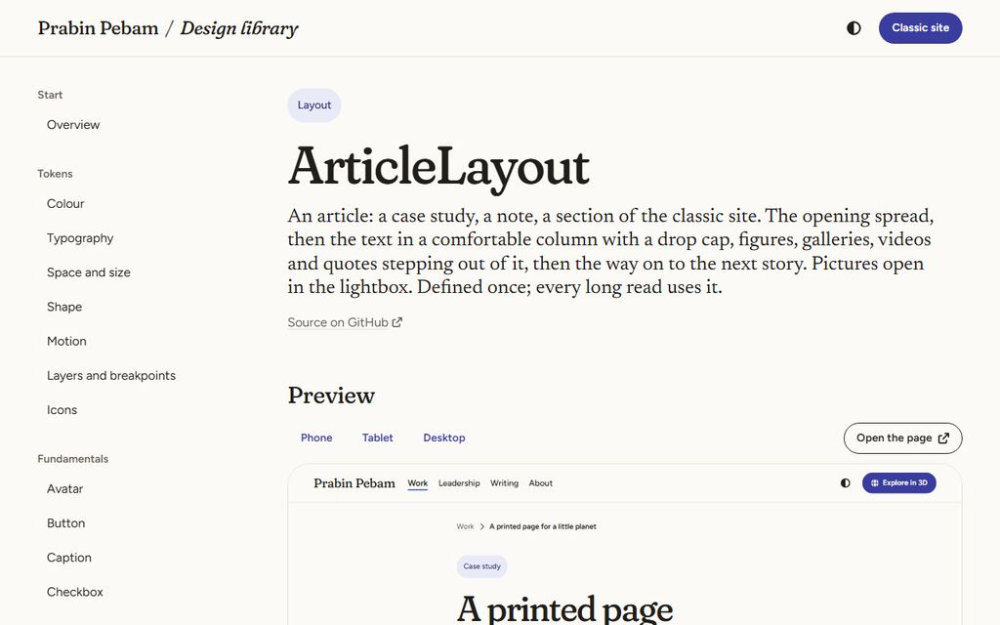

# Site design system

The rules for the website's pages: the landing, the classic site and the design library. The game has its own system ([game UI design system](../game-ui/design-system.md)); the two share nothing but the base-path helper. Read this before any change to the site's UI. The look is in [the visual language](visual-language.md), the reasoning in [the spec](spec.md), the tokens in [the reference](tokens.md), and the living catalogue at `/design/`.

> **TL;DR.** Four tiers: **tokens → fundamentals → compounds → layouts**, each made only from the tiers below it. Every value is a token; tokens are W3C DTCG 2025.10 with a light and a dark context. Fundamentals are sealed; compounds lay them out but never restyle them; layouts are whole pages, defined once; pages hold content and no styles. Every component documents itself (a doc comment and typed, commented props) and has a story, and the design library builds its pages from them. `tests/unit/siteDesignSystem.test.ts` enforces all of it.

## 1. Principles, in order when they conflict

1. **Pictures and words first.** The interface is quiet; whitespace is a token, not an accident.
2. **Accessible by default.** Native elements first; WCAG 2.2 AA in both modes; 44 px targets; the keyboard works everywhere; reduced motion honoured.
3. **One source per decision.** A value lives in a token, a behaviour in a pure module, a component in one file.
4. **Made only from what's below.** No sideways or upward imports; no reaching inside a lower tier's markup.
5. **Documented where it lives.** The component's own comments and types are its documentation.
6. **Nothing from a third party at run time.** Fonts are self-hosted; video embeds load nothing until pressed; no CDN.

## 2. Tokens (tier 0)

- **Source:** `src/site/design/site.resolver.json` (DTCG 2025.10).
  - The base set is `tokens.json`: primitives `p.*`, the type, space, shape, motion and layer scales, and the component tokens `c.*`.
  - The `theme` modifier adds `tokens.light.json` or `tokens.dark.json`, the colour roles.
  - The `contrast` modifier (`normal` or `more`) adds `tokens.contrast-more.json` when the reader asks for more contrast. It points the muted text, outlines and rules at their strong roles (aliases, so one file serves both themes), and the build writes them inside `@media (prefers-contrast: more)`.
  - Values use the 2025.10 objects (colours `{colorSpace, components, hex}`; dimensions and durations `{value, unit}`).
  - `$extensions` holds only vendor data: `site.fluid.min` (a fluid size's value at 360 px), `site.unit` (a number's CSS unit: tracking, underline offsets and the components' type details in `em`), `site.owner` (who reads a component group: below), `site.sizes` (a picture width scripts may read: below) and `site.css` (how a composite is written: `drop-shadow` writes a shadow as the filter function).
- **Build:** after any change, run `node scripts/build-site-tokens.mjs`. It writes `src/site/styles/tokens.css`, [tokens.md](tokens.md), `src/site/design/responsive.ts` and [the token changelog](token-changelog.md); never hand-edit any of them. The unit test fails on stale output.
- **Tiers of tokens:** a component reads semantic roles and scales (`--color-*`, `--text-*`, `--space-*`, `--radius-*`, …) or component tokens (`--c-button-*`). **Never a primitive (`--p-*`)**: only tokens and the library's token pages read them. A component token aliases a semantic role, never a primitive.
- **Who reads a component group.** Every `c.*` group says so in `$extensions["site.owner"]`, and [tokens.md](tokens.md) shows it:
  - **owned** (`"site.owner": "Button"`): only that component reads it (`c.button`, `c.carousel`, `c.story-card`, …);
  - **shared** (`"site.owner": "shared"`): any component may read it. Only groups that are a family's common decisions are shared: `c.control` (every control's height and padding), `c.check` (Checkbox and Radio), `c.list` (rows that take a background), `c.image` (every picture), `c.quote` (Quote and Prose's blockquote), `c.icon`, `c.scrollbar` and `c.editor`.

  To choose: a value one component decides is owned by it. When a second component needs it, ask whether they're one family (then share the group and say who in its `$description`) or whether the second only needs something like it (then it gets its own token, as `ScrollArea`'s heights and `StoryCard`'s row picture did). A value every page needs, like the top bar's height, is semantic (`--size-chrome-block`), not a component's. A test fails on any read across owned groups.
- **Feedback and type details are tokens too.** A press, a check's pop, a lift and a picture's zoom are `--scale-*` by intent (smaller things squeeze more), a button's press-in is `--shift-press`, and a link's underline is `--underline-offset` / `--underline-thickness` (the current page's mark in a nav is `--underline-offset-marker`). A heading that's a link is never underlined at rest: it's drawn in the text colour (a card's title, an album band's, a Spotlight slide's take the highlight's underline only under the pointer or a press; the home's highlight slide takes the accent's hover colour instead, with no underline). The drop cap, inline code, the new-tab arrow and an icon in a line read their component tokens in `em`. The only `em` written in a stylesheet is `1em` (an icon as tall as its text), and the only literal transforms are `0`, `1`, percentages and quarter turns (tested).
- **Modes:**
  - A colour role that differs between the contexts is emitted as `light-dark()`.
  - The page follows the system unless `<html data-theme="light|dark">` says otherwise. The header's theme switch (and edit mode's and the planet frame's, the same control) sets it, `localStorage['site.theme']` keeps it, and PageShell applies it before the first paint. Every other open page of the site follows a change at once (the `storage` event, `followTheme` in `scripts/theme.ts`). The game UI shares the choice through its own theme helper and same-origin frame messages, without importing the site's design system ([sections §6.2](../sections/spec.md#62-the-planet-frame)).
  - Any subtree can switch with `color-scheme` (`data-scheme="dark"`). Never branch on the theme in CSS or script, with one exception: a picture's dark mode version ([media §10](../content/media.md#10-dark-mode-versions)). An `` can't take its picture from a colour role, so `Image` draws a `<picture>` whose dark `<source data-dark>` answers to `prefers-color-scheme`, and the page's head and `followThemeInPictures` (`scripts/theme.ts`) point it at a chosen theme. Nothing else reads the theme.
- **Type styles are typography tokens.** A small type style the interface repeats (a field's label, a choice's words, a hint, a note) is one DTCG `typography` composite in the `type` group, written as the CSS `font` shorthand (`--type-label: var(--weight-semibold) var(--text-sm)/var(--leading-ui) var(--font-ui)`), so a component sets it with one declaration, `font: var(--type-label)`. The shorthand can't carry letter spacing, so that stays the element's; it also resets the numeral style, so an element that should keep its context's figures says `font-variant-numeric: inherit`. `font` takes nothing else (tested).
- **Fluid sizes:** type and whitespace grow between a 360 px and a 1280 px viewport, emitted as `clamp()`. A fluid token's maximum is at most 2.5 times its minimum (WCAG 1.4.4; tested).
- **Breakpoints:** `@media` and `@container` can't read a variable, so width queries use exactly the breakpoint tokens: 40 rem, 56 rem, 72 rem (tested, in either syntax: `(max-width: 40rem)` or `(width < 40rem)`). A container query may also use a size token its own component owns, marked `site.container` (`c.collection.query-narrow`, `c.story-card.query-feature`, …): the test holds it to the owner's file.
- **A compound placed in a column sizes itself by the column, not the screen.** Collection, StoryCard and Carousel are containers (`container-type: inline-size`) and lay out their insides with `@container (width < …)` at their own size tokens, so a card in a narrow column gets its narrow layout on a wide screen too; their scripts ask the same question of their own width against the same token (`narrowerThan` in `scripts/media.ts`), never `matchMedia` (tested). Each size is the column the component had where the old screen query switched, so the pages look as they did: the column a 640 px window gives (`query-narrow`, `query-row`: 36.45 rem), and the index's or a wide figure's column just under the 896 px window (`query-feature`, `query-two-up`: 49.5 rem, which also keeps the design library's 798 px examples as they were); a content-width collection switches at its measure (40 rem). Only the layouts that read their width are containers (a collection's tiles, masonry, timeline and rows with pictures): a container's width can't come from its content, so place one where its width is given (a grid track, a block); the library's tile examples are stacked (`layout="stack"`).
- **Breakpoints and widths in scripts and props:** a `matchMedia` query or a picture's `sizes` can't read a custom property either, so they come from the generated `src/site/design/responsive.ts`: `media('md')` is `(max-width: 56rem)` (`media('sm', 'min')`, `media('short')` for the height), and `sizes(['popout', '92vw'], 'popout')` is `(max-width: 52rem) 92vw, 52rem`, taking breakpoints, measures, a share of a measure (`{ share: 'wide', of: 3 }`) and the picture widths flagged `site.sizes`. No `matchMedia` query or `sizes` in `src/site` holds a rem literal (tested). A picture shown whole in a frame of another shape (`display: fit` with a ratio) asks for the width it really takes: `Image` scales the `sizes` it's given by its share of the frame (`fittedSizes` in `design/pictures.ts`), so a square thumbnail in a 3:2 card fetches the file for two thirds of the card. Where a layout stops growing (the index past the `wide` measure), a `sizes` ends at a share of that measure, not a share of the viewport (`StoryCard`).
- **Every token is read:** by a style or a script, by another token, or (a breakpoint) by a query. One nothing reads is removed (tested), except a deprecated alias in its one release (below).
- **Every change is in the changelog:** the build compares the tokens with the last set it built (`src/site/design/token-history.json`, generated and committed with them) and writes what was added, removed, renamed, changed in value or deprecated to [the token changelog](token-changelog.md), under that day's date. Owners and other `$extensions` aren't values and aren't recorded. `--check` fails when the tokens changed without a build, and running the build fixes it.
- **Renaming or removing a token (the deprecation rule):** never in one step, because a page, a theme or a site built from an engine release may still read the old name.
  1. Add the new token with the old value, and turn the old one into an alias of it marked with DTCG's `$deprecated`, saying what to use instead: `"$value": "{c.card.thumb-width}", "$deprecated": "Use --c-card-thumb-width"`. A token removed for good gets `$deprecated` with what replaces it.
  2. Move every reader to the new name in the same change. The build still writes the old custom property, so nothing breaks, and marks it in [tokens.md](tokens.md) and the changelog, which lists the pair as renamed.
  3. Keep the alias for one release (the next engine release), then remove it.

  `tests/unit/tokenChangelog.test.ts` fails when a source, or a live token, reads a deprecated name.
- **Themes change token values, never components** ([theming](theming.md)): a site's theme (spacing, corners, fonts, the type ramp, colours) is written as custom properties over `tokens.css` (`:root:root`, from `src/site/theme/`), so every component follows with no change. A new token a theme should reach goes through the theme's base (`src/site/theme/base.ts`), and the site's own theme (Atiya) writes nothing.

### Icons, behaviour and base (also tier 0)

- **Icons** are Font Awesome Pro *Duotone* (licensed to the site's owner), imported one by one as data:
  - `src/site/design/icon-set.json` lists them: the name components use, then the Font Awesome name (`classic-solid/` in front for one Duotone lacks, like `plus`). Brand marks use the library's `brands/` style, never a redrawn duotone interpretation: `github=brands/github` identifies the public contribution chart's profile link.
  - An icon of the site's own (the little planet, the new-tab arrow) is an SVG in `assets-src/site-icons/`, listed as `file:<path>`: in the same two-layer format, or one plain path already in SVG coordinates (one layer, in the text colour).
  - `node scripts/import-site-icons.mjs <name>=<font-awesome-name>` adds one from the owner's local copy of the library and writes the generated `iconData.ts`, with the font coordinates flipped to SVG ones. Never hand-edit that file. Import only what the site uses, and look at a new icon before using it: some of the library's names draw something else (its `volume-high` is a speaker cabinet, its `clock` a watch).
  - `svgOf(name)` gives the inline SVG's box and its two layers. The primary layer (`.icon-primary`) takes the text colour; the secondary (`.icon-secondary`) is printed under it in the spot indigo (`--c-icon-secondary`: indigo-400 on light, 3.2:1 on paper; indigo-300 on dark), like a two-ink print. An icon with one layer (a check, a chevron) is all primary.
  - A status is **tonal** (`data-icon-tone="tonal"`, the Icon's `tone`): both layers in its own colour, the second at `--c-icon-tonal-opacity`. So are icons on an accent fill (primary Button and IconButton) or a marigold one (Tag), where the second colour would sink into the fill, and every icon in forced colours.
  - No icon font, no CDN, no package, no emoji or text symbol.
- **Behaviour** that isn't just DOM wiring is pure and unit-tested in `src/site/scripts/`:
  - `listbox.ts`: the select's APG keys and typeahead;
  - `theme.ts`;
  - `media.ts`: wrapping, swipes, the nearest slide;
  - `controls.ts`: the slider's values;
  - `page.ts`: runs a component's script on every page, including pages swapped in without a reload (§4);
  - `scrollbars.ts`: the overlay scrollbars (§3): the handle's size and place (`thumbGeometry`) and dragging it (`dragTo`);
  - `minimap.ts`: the article minimap's rules ([the minimap](minimap.md)): the current landmark, the wave, edge auto-scroll, the jump's landing, which pictures count, the preview's placement;
  - the large components' wiring, kept out of their files so they stay short (each set up from the component's `each(…)`): `articleMinimap.ts` (the minimap), `carousel.ts`, `collection.ts` (a collection's layout from its items and width, its strip's steps, and its item's types) with `collectionStrip.ts`, `siteHeader.ts` (the header's menu, More and tucking away, with `header.ts`'s pure rules) and `select.ts` (with `listbox.ts`'s pure rules); `units.ts` reads a token's number; `media.ts` also gives a video file's sources to `Video` (`videoSources`).
- **Base styles** (`src/site/styles/base.css`) set element defaults: the reset, type, links, the focus ring, selection, and `.sr-only`.
- **Recipes written once.** A decision several components share is written once, never copied (fewer than 25 identical declaration blocks across the fundamentals and compounds, tested; `node scripts/design-system-audit.mjs` measures it):
  - as a **token**: a type style (`--type-*`, above), a picture's drop shadow (`filter: var(--c-image-shadow-filter)`) and the room a sideways scroller keeps for it (`--c-image-shadow-room`);
  - as a **base.css recipe**, keyed by a data attribute the component puts on its own markup (so it reads as the component's, and nothing global changes): a control you press (`data-press`: faded, with the not-allowed cursor, while `:disabled`, `aria-disabled` or `data-disabled` and not busy); the focus ring round a wrapper (`data-focus-ring`: `child`, `inside` or `within`; a plain `:focus-visible` already has it); a card that's one link (`data-card` on the card, `data-card-link` on its title's link, which stretches over it; the card rounds the ring itself); a field's parts (`data-field-part`: `root`, `head`, `hint`, `note`); and a check's layout (`data-check-part`: `root`, `box`, `words`, for Checkbox and Radio); and a combobox's suggestions (`data-suggestions` on its listbox: a raised list, each `role="option"` a touch-sized row, the marked one `aria-selected` in the spot colour; Keywords and Questions); and a disclosure's chevron (`data-chevron` on the icon's wrapper: it turns over while the control holding it is `aria-expanded`; Keywords' and Questions' rows on a phone); and a row of tags (`data-tag-list` on the `ul`: wrapping, without bullets; a page's topics in ArticleHeader, StoryCard and HighlightCard, and HomeLead's facts). A component adds only what is its own (its ring's radius, its press);
  - as a **tier 0 type**: a picture's file is `PictureSource` and a card's picture `CardPicture` (`design/pictures.ts`), never an inline `{ src; srcset; width; height }` (tested). A component that keeps its item types in tier 0 re-exports them (`export type { CollectionItem } from '../../scripts/collection'`), and the library documents them on its page.
- **Assets:** the font cuts in `src/site/assets/fonts/` (generated; §9).
- **Helpers:** `src/site/design/meta.ts` (the base path and the theme colours), `samples.ts` (the library's sample media) and `typography.ts` (curly quotes).

## 3. The tiers

| Tier | Folder | May import |
|---|---|---|
| 1: fundamentals | `src/site/components/fundamentals/` | Tier 0 only (no other component; icons through `svgOf`) |
| 2: compounds | `src/site/components/compounds/` | Fundamentals and tier 0 (no other compound) |
| 3: layouts | `src/site/layouts/` | Compounds, fundamentals and tier 0 (no other layout) |
| Pages | `src/pages/index.astro`, `src/pages/classic/`, `src/pages/design/` | Layouts, and components in their content; no `<style>` (the landing and classic pages) |

- **Fundamentals are sealed.** They take no `class` or `style` prop. They pass `data-*` attributes through, and set inline only data custom properties (`--fill`, `--focus`).
- **Compounds lay fundamentals out from their own elements.** Wrap a fundamental in the compound's own element to place or size it; never style inside it.
  - `:global` is banned, except where a component styles markup it didn't write: Prose (Markdown), the Lightbox and VideoEmbed (elements their scripts create), and edit mode's canvas overlay and inspector (the text the browser writes while it's edited). The test holds this list.
- **One instance per page, composed by the layout.** Some pieces are page-wide: the Lightbox, for one. A compound that needs one never imports it. It marks its links (`a[data-lightbox="group"]`) and the layout places one `<Lightbox />`.
- **Place, don't position.** Figures, galleries, quotes and videos declare how far they step out of the text (`data-breakout="popout|wide|full"`); Prose's grid places them.
- **Layouts are defined once.** A page picks the layout that fits; a new kind of page gets a new layout only if no existing one fits, and that layout is then reused.
- **IDs are unique per instance** (a random suffix), so a page can show a component twice, as the library does.
- **The footer rests on the bottom edge.** The page (`body`, base.css) is a column at least as tall as the viewport, and each layout's one content block grows (`flex: 1 0 auto`). So on a short page the footer sits on the bottom edge with no gap under it, and on a long one it follows the content. A content block that centres itself with auto margins also takes `inline-size: 100%`, so it doesn't shrink to its content. A grid one takes `align-content: start`, so the extra height doesn't widen its gaps. A layout is the header, one content block and the footer: a sticky header needs the flex column (in a grid it could only stick inside its own row).
- **Scrollbars are overlays.** No native bar anywhere: no gutter (a scroller keeps its whole width) and no arrow buttons. Instead a frosted handle floats over the edge at the scroll position: indigo-tinted glass (`--c-scrollbar-thumb`) over a blur (`--c-scrollbar-blur`), with a light rim.
  - It shows while the scroller is hovered, scrolled or focused from the keyboard, or while it's being dragged, and fades out at rest. The page's own handle also shows while the pointer is near its edge. It widens to `--c-scrollbar-size-hover` to be grabbed and dragged.
  - Scrolling stays native (wheel, touch, keys); the handle only shows the position and can be dragged. It's `aria-hidden`.
  - A scroller opts in with `data-scrollbar` (base.css hides its native bar; PageShell's script adds the handle through `scripts/scrollbars.ts`). Prose adds it to Markdown's code blocks. The carousel's slide track alone has no handle: its buttons and dots move it. A unit test fails on native scrollbar styling, or on a component that scrolls without opting in.
  - Reduce transparency gives a solid handle (`--c-scrollbar-solid`), and forced colours a plain one in the text colour.
  - A horizontal ScrollArea never lets its content set its width (`contain: inline-size`): it scrolls instead of pushing the page wider.
- **Lists whose items take a background** (hover, selected, current: the dropdown's options, the side navigation, the phone menu) keep a little room between items, `--c-list-item-gap` (4 px), so a hovered item never merges with the selected one beside it.

## 4. Writing a component

1. **The file.** Create it in its tier's folder, named in PascalCase. Its frontmatter starts with a doc comment:
   - a plain-language summary: what it's for and when to use it (and when not);
   - `@tier fundamental|compound|layout`;
   - `@a11y` notes;
   - `@key Keys: action` lines if it takes keys.

   Every prop in `interface Props` has a JSDoc comment. Defaults go in the `Astro.props` destructuring, because the library reads them. A prop being renamed or removed follows the token rule (§2): it keeps working for one release, marked with a JSDoc `@deprecated <what to use instead>` tag, which the library's props table shows as a Deprecated tag, and `tests/unit/deprecation.test.ts` fails if any `.astro` file still passes it.
2. **Styles and script.** Styles are scoped, in the file, from tokens only. A client `<script>` initialises every instance through `each('[data-…]', (el, signal) => …)` (`src/site/scripts/page.ts`), never a bare `querySelectorAll` loop: a bundled script runs once, but the library swaps pages in without a reload, and `each` sets up each new page's elements, once each. Pass `signal` to every listener on `window`, `document` or a media query, so a swapped-out instance stops listening. A listener that must live for the whole document (the side nav, kept across swaps, carries its scroll over) sits at the module's top level with a comment that starts `// once per document:` and says why; the test reads it. Logic beyond wiring goes in `src/site/scripts/` with a unit test.
3. **The story.** Add `src/site/stories/<Name>.stories.astro` with one `<Example title="…" description="…">` per variant or state. What's inside each Example is what the library shows as code, so keep it clean. Use `withBase()` for root-relative links, real copy about the site (never lorem ipsum or invented personal facts), and `SAMPLES` or `SAMPLE_VIDEO` for media. A layout's story is a whole page: the library frames it at `/design/demo/<slug>/`.
4. **Check it.** The library page appears by itself at `/design/<tier>/<kebab-name>/`. Run `npx vitest related <file> --run` and the "site design system" E2E group if it has behaviour.

## 5. The catalogue

The design library is the full, live version (examples, props, keys, tokens, uses and used by). In brief:

| Tier | Components |
|---|---|
| **Fundamentals** | **Type:** Heading, Text, Link, Caption, Prose, Quote, Tag, Divider. **Media:** Icon, Image, Video, Avatar. **Actions:** Button, IconButton, ButtonGroup (related buttons joined into one control: a set of actions, or choices with one on), BackToTop; RowButton (a row in a list that shows or picks what it names: a name, a detail line, an optional icon, current or pressed), TileButton (a tile that picks what it holds: outlined, framed, chip, thumbnail or bare; given an address, a link with the same frame, for a tile that opens something) and MenuItem (a command in a `role="menu"`). **Form controls:** Select (the custom dropdown), Checkbox, Radio, RadioCard (a radio drawn as a card, the native input hidden in it), Switch, TextField, FileField, ColorField (the system's colour input as a swatch beside its label), Slider, HiddenField (a value a form carries without showing it). **Feedback:** Progress, Spinner, Skeleton. **Scrolling:** ScrollArea (the custom scrollbar) |
| **Compounds** | **Page frame:** PageShell, SiteHeader, SiteFooter, SideNav, Breadcrumbs, NextPrev. **Openings:** Hero, ArticleHeader, Facts. **Indexes:** StoryCard, ContentsList. **Media:** Figure, Gallery, Lightbox, Carousel, VideoEmbed. **Wayfinding:** ArticleMinimap ([the minimap](minimap.md)), RelatedStories ([what to read next](../sections/spec.md)). **Forms:** ChoiceGroup. **Arrangements:** SplitView (a list beside the details of what's chosen in it: the list's column narrow or wide, stacked under 56 rem; edit mode's Sections, Recommendations and Access screens), ActionBar (a row of actions that wraps: at the start, at the end, or apart, with a md or sm gap) |
| **Layouts** | **LandingLayout** (the front page), **IndexLayout** (a section's front page), **ArticleLayout** (a long read: case studies, notes, the classic sections), **LibraryLayout** (the design library) |

## 6. The design library (`/design/`)

- **Built from the source.** `src/site/library/registry.ts` reads every component at build time:
  - the doc comment;
  - `interface Props`, through the TypeScript compiler;
  - the tokens its styles read;
  - its imports, which give "uses" and "used by";
  - its story.

  Nothing in the library is kept by hand: a component and its story are its page.
- **Examples:** each `<Example>` renders the real component, with a Light or Dark preview switch (it sets `color-scheme` on the canvas) and its source cut from the story file.
- **Token pages** (`src/site/library/tokens/`) show tokens as what they are, read from the resolved model, and are the one place primitives are shown.
- **Library-only helpers** (Example, CodeBlock, PropsTable, ViewportFrame, the token views) live in `src/site/library/`. They follow the token rules but aren't a tier: product code never imports them.
- **Moving around without a reload.** Library pages change through Astro's client-side router (`PageShell`'s `router`, set by the LibraryLayout only), so you don't lose your place in the side navigation:
  - The navigation is kept across pages (`transition:persist`), with its scroll and its fold. SideNav's `follow` marks the new page as current and brings its link into view only if it's out of sight.
  - The chosen theme carries over to each swapped-in page. The new page's title is announced, and Back and Forward work.
  - Links out of the library (the classic site, the layout demos) are ordinary page loads. Every other page ships no router.
  - The E2E test "the library changes pages without a reload" holds this.

## 7. Accessibility

- **Contrast:** every text role passes 4.5:1 on every surface in both modes; outlines, the focus ring and checked fills pass 3:1; text on a picture sits on the image shade. The marigold highlighter is never text on paper; its type version (`--color-highlight-ink`) is. All tested.
- **Focus and targets:** a 3 px focus ring in indigo (light) or marigold (dark). Targets are at least 44 px; small buttons pad their hit area.
- **Native first:** real inputs (restyled with `appearance: none`), `<dialog>` for the lightbox, `
` for the side navigation's fold. The select follows the APG select-only combobox, key for key.
- **Motion:** reduced motion turns off every animation. Nothing plays by itself unless the author asks: a video file set to autoplay (off by default) plays muted while at least half of it is in view, pauses when it leaves, keeps its controls, never starts again by itself once the reader has paused it, and never starts at all under reduced motion. A carousel moves on by itself only with `autoplay` (off by default; on for the home's highlights): its active pill pauses and plays it (named Pause slides or Play slides, showing a pause or play sign as the mouse comes to it; no button of its own), holds while the mouse moves over its slides (the pill a pause sign, until 6 seconds after the last move), it's dragged, the page is hidden or it's out of view, stops for good when keyboard focus comes in (APG), silences its counter while it plays and starts paused under reduced motion. `loop` makes its first slide follow its last.
- **Structure:** one h1 per page; a skip link first; landmarks with names; `aria-current` on the current page; live regions for counters.
- **Links and tabs:** relative links and absolute links anywhere under `prabinpebam.github.io` stay in the current tab. An HTTP(S) link that leaves that parent domain opens a new tab with `noopener noreferrer` and ends with the new-tab sign (`newTabSign()` in `design/links.ts`): a small arrow (the `base.css` recipe `[data-new-tab]`, sized by the text it follows through the `c.icon` `new-tab-*` tokens, and held by generated word joiners to the last word and any punctuation after the link, so it never starts a line on its own) and the accessible note “opens in a new tab”. Every link with words draws it: the header, a contents list, the footer, a link, a button, a tag, a quotation's source and an article's text. An icon-only button and a picture cell say it in their accessible name alone. `mailto:`, telephone, fragment and download links keep their browser-native behaviour. A same-domain link may open a new tab only to preserve a task in progress (for example, previewing the public page from edit mode or leaving the planet’s reading frame), and it carries the same note.
- **Checked by axe** in both modes on the library, the layouts and the pages (the E2E group).

### Phones and touch ([the mobile audit](mobile-audit.md))

- **Hover is an enhancement.** Every `:hover` rule sits inside `@media (hover: hover)`, so a tap never leaves a phone stuck in a hover state (tested). Anything with hover feedback also has a pressed state (`:active`) for touch.
- **No grey tap flash, no double-tap delay.** Base styles turn off the tap highlight and set `touch-action: manipulation` on controls; pinch zoom stays, and zoom is never disabled.
- **Reflow from 320 px:** no sideways scroll at any width (tested at 320, 360, 430 and 844×390). Long words break; running text hyphenates below 40 rem.
- **The first screen:** on a phone, upright or on its side, the page's heading (and the landing's primary action) is on it.
- **The header is compact on phones** (`--size-chrome-block-compact`, below 40 rem or 30 rem of height), tucks away while you read down, and returns on the way up or on focus. What clears the top bar (a sticky column, a scrolled-to heading, the minimap's inset) reads `--size-chrome-block`, never the header's own token.
- **Everything reachable on a phone:** the header's action moves into the menu (or to the footer where there's no menu). The menu closes on a tap outside and scrolls inside on a short screen.
- **Height queries** use the `short` breakpoint token (30 rem), as width queries use theirs.
- **Contrast settings:** `prefers-contrast: more` (iOS Increase Contrast) strengthens muted text to 7:1 or more, outlines to 4.5:1 and rules to 3:1 (tested). In forced colours, a state shown by a fill (the current page's pill) gets a non-colour mark too, such as an underline.

## 8. Copy

- **Case and labels:** sentence case. Buttons are verbs of three words or fewer; field labels are nouns; errors say what happened and how to fix it; no "OK", "Submit" or an instruction to click.
- **Symbols:** curly quotes and apostrophes in visible copy; no emoji or text symbols as icons.
- **Words:** the glossary is the game's (planet, classic site, the plaza), plus design library, standfirst, story.

## 9. Performance

- **No game code:** site pages load none (tested on the landing). Their scripts are small per-component modules.
- **Fonts, cut to what the site uses:** `python scripts/build-site-fonts.py` pins the axes the site never varies (Fraunces' SOFT and WONK, read from the `axes` tokens) and keeps optical size and weight. Newsreader is cut to the weights the tokens use. It writes `src/site/assets/fonts/` and `src/site/styles/fonts.css`; never hand-edit either.
  - **Weight:** 159 to 241 KB on a page, italics fetched only when used.
  - **Preloads:** each layout preloads the faces its first screen is set in (`PageShell`'s `preload`), so text doesn't re-wrap as fonts arrive: the Fraunces italic only where the opening has a standfirst (or, in the design library, the header's italic section name), since it's the largest file. A face the first screen doesn't use isn't preloaded; it still loads, when it's used.
  - **The playground:** only the library's type playground loads the full four-axis Fraunces (`--font-specimen`).
- **Pictures:** sized, `srcset`, `loading="lazy"` unless they're the lead, so the browser fetches what's in view first. How they load (`scripts/pictures.ts`, from the `Image` fundamental):
  - **While loading,** a picture's place shimmers in its own shape and corners (`c.image.placeholder`, `c.image.shimmer`; still under reduced motion), and the picture fades in once it has loaded (`c.image.fade-in`). Never a broken icon or its alt text in its place.
  - **A failed load** is tried twice more (after 0.8 s and 2.4 s), then its place stays quiet.
  - **Once the page has loaded,** every picture still waiting is fetched, nearest the view first, four at a time. One in a sideways scroller (a carousel, a filmstrip, a row gallery) counts as near as its scroller, and a scroller coming into view fetches all its pictures at once, so a slide is there before it's swiped to. A picture held back unseen (`display: none`) waits until it's shown.
  - **A private page's pictures** are all decrypted the same way, nearest first, three at a time, one coming into view jumping the queue, each fetch tried three times (`scripts/sealed.ts`).
  - **The lightbox** starts a picture's full size when its link is pointed at or focused, and once open warms the rest of the set, nearest the picture shown first: the whole set when it has 24 items or fewer, else the 4 on either side, again after every move.

  Videos load their metadata only.
- **Measured on a phone** (Lighthouse's mobile throttling): LCP under 2.5 s and CLS under 0.1 on the landing, the index and a section ([the mobile audit](mobile-audit.md) §4).

## 10. Checks

| What | Command |
|---|---|
| Tokens up to date | `node scripts/build-site-tokens.mjs --check` (also in the unit test) |
| Fonts up to date | `python scripts/build-site-fonts.py --check` |
| Icons up to date | `node scripts/import-site-icons.mjs --check` (also in the unit test; without the library it checks only that the data covers the set) |
| The rules | `npx vitest run tests/unit/siteDesignSystem.test.ts tests/unit/siteRecipes.test.ts tests/unit/responsive.test.ts tests/unit/siteBehaviour.test.ts tests/unit/siteControls.test.ts` |
| In the browser | `npx playwright test -g "site design system|site on a phone|landing & classic"` |
| Types | `npm run check` |

Beyond the tokens and raw values, `siteDesignSystem.test.ts` holds: components at most 500 lines (350 without styles), the recipes written once (the copied-block count, the disabled state, focus ring, card link, picture shadow, label type and picture-source type each in one place), the compounds in a column sizing by their container, who reads each component group (ownership), every token read, transforms, `em` and grid tracks from tokens (the library's specimen pages and the stories' sample grids excepted, by name), `sizes` and `matchMedia` from `responsive.ts`, every window, document and media-query listener passing `signal` (or, once per document, saying why: the side nav's three), and every story showing each value of its component's union props (or the prop naming the story that shows it).

The audit that added these checks, and what each closed, is [the design systems audit](design-system-audit.md).
